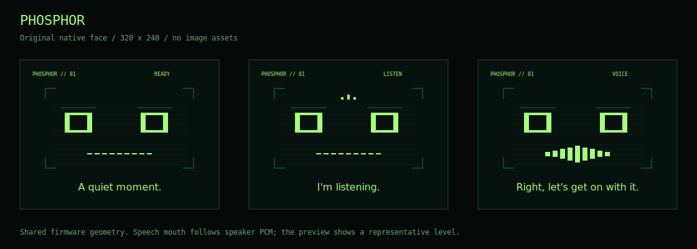

# PHOSPHOR

A fresh voice companion for the **M5Stack StackChan K151 / CoreS3**. Original green terminal avatar, local smooth head motion and stock-compatible streaming voice. No external sensors, camera features or desktop server.



This is a custom application on M5Stack's maintained hardware and Xiaozhi voice foundation. It contains no Kadence application code. General conversation still uses Wi-Fi and the configured cloud service; PHOSPHOR is not an offline general-purpose LLM.

- **Voice first:** removes a 100 ms sleep inside the display lock during conversation; bounded blocking UART reads; quieter idle movement; local codec recovery.
- **Native face:** no face bitmap or GIF, capped at 25 Hz with speaker-amplitude mouth motion. Motor loop requests 50 Hz. Hardware timing is not yet measured.
- **Focused controls:** voice and setup apps, stock onboarding, calibration, power management and built-in touch. Camera initialisation and unused applications are removed from the active build.
- **Predictable updates:** exact dependency commits, required patches, one candidate version. Automatic stock firmware replacement is disabled.

[Research and design decisions](docs/research.md) · [All observed recent releases](docs/release-catalogue.md) · [Build comparison and validation](docs/validation.md) · [Flashing and one acceptance pass](docs/FLASH.md)

## Build

Use **ESP-IDF v5.5.4**, target ESP32-S3. From an activated IDF shell:

```sh
python3 firmware/fetch_repos.py
cd firmware
idf.py build
cd ..
python3 tools/package.py
```

The package is `dist/PHOSPHOR-CoreS3.zip`. It contains segmented flash images, checksums and a backup-first flashing helper. It does not contain credentials. Do not use it on Core2, AtomS3R or a bare CoreS3 without the StackChan base.

Focused host checks:

```sh
cmake -S firmware/tests -B /tmp/phosphor-tests -DCMAKE_BUILD_TYPE=Debug
cmake --build /tmp/phosphor-tests -j4
ctest --test-dir /tmp/phosphor-tests --output-on-failure
```

The GitHub workflow builds one artifact; it does not publish releases. Local firmware compilation and all four host checks passed. **Physical flashing, voice latency and servo smoothness remain to be verified on the robot.**

## Provenance

Stock base: [m5stack/StackChan](https://github.com/m5stack/StackChan/tree/f901cc2969189f3f0e96af1442c0f96e77e1e2c1). Original file licence notices remain in place. New PHOSPHOR code is MIT licensed; third-party components keep their own licences. [THIRD_PARTY.md](THIRD_PARTY.md) records design references. The repository is firmware-focused; stock phone/server/remote source is available in the upstream project.
