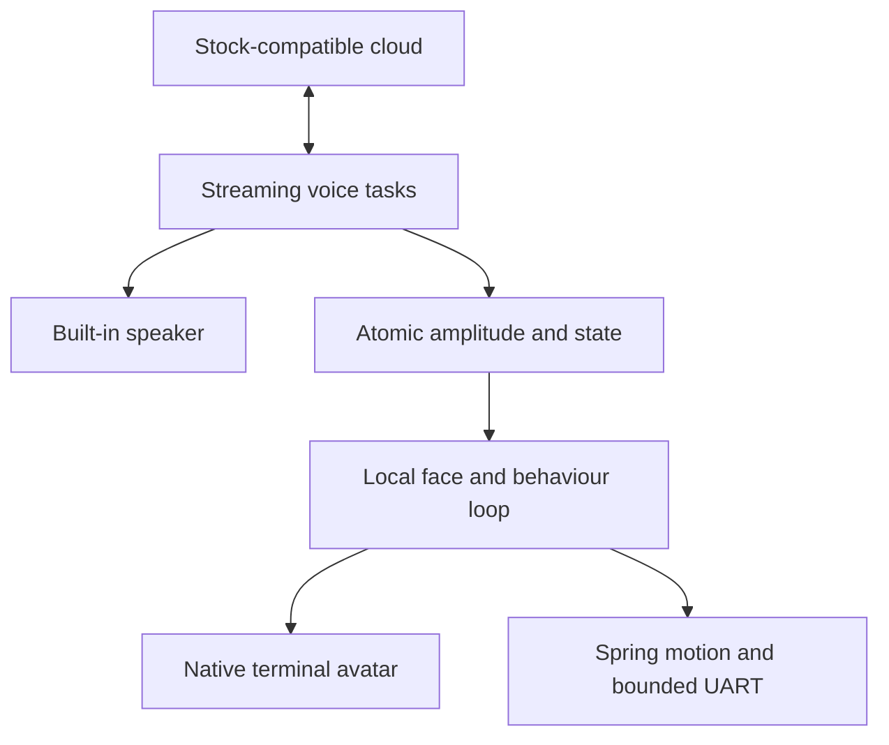

# PHOSPHOR: StackChan firmware review and fresh build

29 October 2026. Scope: stock M5Stack StackChan K151/CoreS3, built-in microphone, speaker, display and servos. No external sensors, camera use, desktop agent, or Kadence code.

**Decision: keep the existing hardware and start a new application on the maintained M5Stack board support and streaming voice transport.** Replace the face, remove unused applications, and repair the local scheduling and I/O problems. This preserves a useful stock response-speed baseline. It does not make cloud inference run on the ESP32.

## Search coverage

The search covered **743 candidate repositories** and found **219 release entries in 55 repositories** with `published_at` in **29 August–29 October 2026 UTC**. This is the broad discovery corpus: it includes firmware, host applications, libraries, model releases, and some adjacent projects. It is not 219 distinct CoreS3 firmware builds.

Queries included `stackchan`, `stack-chan`, names/descriptions/READMEs, recently pushed forks, `topic:stack-chan`, `スタックチャン`, and CoreS3/Xiaozhi combinations. Name searches were paginated. Each candidate's releases endpoint was inspected; high-volume Kai received an additional page check. Failed large responses for Xiaozhi and Stackchan Alive were retried with smaller pages. Published dates, rather than recently edited release notes or recent commits, determine inclusion. For example, Dotty's July firmware release is outside the window even though its notes changed in October.

GitHub search indexing, renamed projects, releases on very old commits, and repositories without recognisable StackChan descriptions mean **global completeness cannot be guaranteed**. The [complete release list](release-catalogue.md) and [machine-readable inventory](release-inventory.json) make the observed coverage reviewable. The inventory retains zero-release candidates too. Generic Xiaozhi asset lists are filtered to relevant board names and checksum/manifest files.

Source inspection was concentrated on the firmware families below. Other entries received release metadata review; they were not all built or physically tested. M5Stack's main StackChan repository has no formal GitHub Releases, so its current source is included separately as the baseline.

## The firmware families that matter

| Family and window releases | What the implementation shows | Decision for this build |
|---|---|---|
| [M5Stack StackChan](https://github.com/m5stack/StackChan/tree/f901cc2969189f3f0e96af1442c0f96e77e1e2c1), current source; [BSP 1.1.1](https://github.com/m5stack/StackChan-BSP/releases/tag/1.1.1), 21 Oct | Board-specific codec, display, calibration and stall protection; Xiaozhi streaming voice; native local spring animation. There is also an avoidable 100 ms wait inside the display lock during conversation. | Use the current stock source as the hardware/voice foundation; remove that wait and narrow the application. |
| [Dotty fw-v1.3.4 / fw-v1.3.5](https://github.com/BrettKinny/dotty-stackchan/releases), 28–29 Oct | Public firmware revision `c074907`; blocking UART reads repair scheduler starvation. Recent work also addresses TCP receive-task lifetime, task allocation failure, and codec I2C recovery. The complete voice stack still needs a host. | Apply independently implemented repairs to our pinned stock dependencies; do not bring over the host, modes or camera system. |
| [Stack-chan 2.0.0 / 2.0.1](https://github.com/stack-chan/stack-chan/releases), 20 Oct | Moddable/TypeScript control with native CoreS3 WebRTC audio, Opus, I2S and AEC tasks. The new realtime module keeps audio work off the JavaScript conversation worker, uses bounded buffers and exposes underrun metrics. Direct OpenAI is opt-in. | Strong next voice-transport candidate if stock cloud latency remains unacceptable. A wholesale runtime change adds integration work without proving a faster result on this robot. |
| [Stackchan-IDF 0.12–0.15 alpha series](https://github.com/ciniml/stackchan-idf/releases), Sep–Oct | Direct conversation backends, separate servo task, internal-RAM playback buffers, streaming playback with a 300 ms conversation jitter buffer, PCM-derived mouth motion. The separate BLE music path uses a much larger ring and preroll; that is not its conversation latency. | Borrow bounded work, sparse feedback and audio-derived animation. Do not copy the music buffering into conversation. |
| [Fairy v1.0 / v1.1 universal](https://github.com/Michae1o/fairy-stackchan/releases), 20 Sep / 6 Oct | Servo motion uses 20 ms smoothstep segments and a generation counter so a newer motion can interrupt an older one. Stall detection checks both lack of movement and load/current, avoiding false stops during acceleration. Its smooth-motion loop still blocks the caller. | Keep stock nonblocking spring updates and stall protection. Use original artwork; no Fairy character assets or voice package. |
| [Kai firmware 0.114.2–0.116.0](https://github.com/andymai/stackchan-kai/releases), 25 Oct | Rust/no_std firmware and arbitration of competing behaviours; voice uploads captured PCM to an operator-configured HTTP endpoint. A lean language/runtime does not remove the external voice dependency. | Useful separation of behaviour priorities. Do not undertake a Rust and HAL rewrite for an unmeasured latency gain. |
| [Nous fw-v3.6, v3.6.6, v3.6.7-dj5/dj7](https://github.com/dax8it/nous-girl-stackchan/releases), 29 Oct | Public releases and server overlays are available, but the firmware patch series is not public. The documented setup relies on external services. Firmware scheduling claims cannot be independently traced through the missing source. | Treat the demo as a design reference, not a reproducible firmware foundation or proof of standalone inference. |
| [Xiaozhi 2.5.0 / 2.5.2](https://github.com/78/xiaozhi-esp32/releases), Sep–Oct | General platform updates include malformed-hello handling and network fixes. The M5Stack port currently pins 2.2.4 plus its own patch, not the newest generic release. | Preserve the compatible board port; add the relevant transport-field checks. Do not silently swap in a newer major SDK/board integration. |
| [sanoTTS-jp](https://github.com/ayutaz/sanoTTS-jp/releases) and [JapaneseTinyAgentLM](https://github.com/ayutaz/JapaneseTinyAgentLM/releases) | Real on-device Japanese TTS and a small Japanese text-to-action model exist. These are meaningful embedded inference advances, with separate model licences. They do not constitute an English microphone-to-general-conversation system. | Track for a future narrow offline command layer. They are not a drop-in replacement for this build's conversational backend. |

MCP gateways, MQTT clients, desktop assistants, Core2/AtomS3R variants, vision stacks and regional forks are catalogued separately. Their existence does not demonstrate a faster independent CoreS3 voice pipeline. In particular, Groki Bot and the ChatGPT-named AtomS3R project still describe computer-side voice gateways.

## Findings that changed the implementation

**1. The stock conversation loop throttles the robot while holding the screen lock.** In [`hal.cpp`](https://github.com/m5stack/StackChan/blob/f901cc2969189f3f0e96af1442c0f96e77e1e2c1/firmware/main/hal/hal.cpp), a 20 ms update delay is followed by another 100 ms delay whenever Xiaozhi is not idle. The second delay occurs after acquiring the LVGL lock. This makes the loop nominally about 8 Hz before other work during conversation, and prevents another display user from taking that lock. PHOSPHOR uses a 20 ms scheduled period and removes the locked sleep. **50 Hz is the requested cadence, not a measured hardware result.** UART and rendering work can still cause overruns.

**2. A seemingly polite UART poll can still spin.** Stock `SCSerial.cpp` uses `vTaskDelay(pdMS_TO_TICKS(1))`; at a 100 Hz tick this converts to zero. Our transport blocks in `uart_read_bytes`, with at least one tick when a wait is needed. It retains both whole-request and inter-byte timeout semantics. The actual transport source is exercised with a timed UART fake at 100 and 1,000 Hz. Missing bytes terminate the read; prompt bytes incur no artificial sleep.

**3. A smooth trajectory needs a steady clock and sensible retargeting.** The spring update now uses elapsed time, capped to 60 ms so a long pause does not cause a large one-step catch-up. Retargeting an active movement no longer teleports the spring to a fresh physical reading on every command. Resting servo feedback is checked every 200 ms rather than every frame. The first target after rest still resynchronises with the physical angle. Existing pitch stall protection and calibration remain. Bounds are narrowed to yaw ±80° and pitch 8–75°; random idle motions are gentler and default to the low frequency setting.

**4. The face does not need GIFs or a large image cache.** PHOSPHOR draws an original green terminal face using integer rectangles, model-only eye features, and two small labels. The face is capped at 25 Hz and invalidated only when its state changes. No face bitmap or dedicated face framebuffer is allocated. The LVGL image-cache limit falls from 2 MiB to 64 KiB for the 8 MiB board. This is a reduction in the configured cache budget, not proof that 1.94 MiB was permanently occupied at idle. The normal display transfer buffer and setup resources still exist.

**5. Mouth movement should reflect the sound.** The codec publishes a sparse amplitude estimate and timestamp after accepted speaker writes. The face reads these atomics and applies an attack/release envelope. No LVGL call or display lock occurs in the audio path. A stale meter falls to zero after 160 ms. It is a speech-amplitude visualisation, not phoneme-accurate lip synchronisation. Random speaking-mouth animation has been removed.

**6. Remove work before buying hardware.** Camera initialisation is disabled, so there is no camera capture allocation and `GetCamera()` is null; the generic voice stack consequently registers no camera tool. Telepresence, dance, remote-control, app-store and EzData apps are excluded from the app build/launcher. Stock setup, Wi-Fi provisioning, built-in touch/IMU, power management and voice remain. This is a focused application on the stock driver layer, not a rewrite of I2S, Wi-Fi or servo protocols.

**7. Repair faults at the appropriate layer.** Codec opens get three bounded attempts and a 500 ms retry backoff. Failed microphone reads supply timed silence rather than uninitialised samples. Volume, gain and close failures are logged rather than invoking a fatal check. The TCP build copy joins its receiver before deleting the event group, wakes blocked receive on shutdown, and rejects task-allocation failure. A receiver that still fails to exit after its bounded teardown wait triggers an explicit abort rather than permitting a use-after-free. This exceptional path has not been fault-injected on hardware. Stock TLS teardown remains a separate implementation; this is not a comprehensive network-library audit.

**8. Preserve the custom build.** Cloud configuration and activation are retained, but automatic provider firmware replacement is disabled. Firmware remains manually updateable. Dependencies are pinned to exact Git commits and the component lockfile; required patches fail the build if they no longer apply. There is one candidate version and no automatic GitHub release publishing.

## Voice latency and independence

The retained audio pipeline streams Opus frames. Its 60 ms frame size and queue capacity are different things: a queue capable of holding seconds of data does not necessarily wait that long before playback. PHOSPHOR adds no full-answer collection step. Audio capture/output retain the upstream tasks and priorities; avatar state and its PCM meter do not gate playback.

End-of-speech detection, network transit, cloud ASR/model/TTS scheduling, first audio delivery and speaker buffering all contribute to the delay the user hears. Local scheduling repairs should help responsiveness under load, but **no numerical speech-latency improvement is claimed without an A/B run on the same network and backend**. The matched build-size result is recorded in [validation.md](validation.md).

The robot needs no Kadence server, desktop gateway or Docker service. It still requires Wi-Fi and a compatible cloud service for open-ended conversation. With the cloud unavailable, its local face and controls remain local; this build does not add offline English recognition or an on-device general LLM. The stock cloud/control-plane provisioning behaviour is inherited. PHOSPHOR is not a replacement backend or a new account system.

The face, modifiers and motor update still share the stock robot task and its lock. Removing the 100 ms locked wait is the immediate improvement. A fully independent motor task would require mailbox ownership of all motion commands, calibration and feedback; that larger change is deliberately not claimed as implemented here.

## What to do next, in one acceptance session

Flash once using the supplied backup-first package. Confirm provisioning or saved Wi-Fi, a clean voice reply, screen-tap interruption, several gentle turns, and recovery from one network interruption. Compare a short fixed set of questions with stock on the same backend; measure end-of-speech to first audible output and note any audio dropouts while the head moves. Keep the question, power source and speaker volume consistent.

If local motion is smooth and audio is clean but replies remain slow, the next change should be the conversational endpoint or direct realtime transport, not another avatar rewrite. If an unplugged/offline English assistant becomes a firm requirement, the compute/hardware question changes substantially. For the stated scope, there is no evidence yet that replacing the CoreS3 is the best use of effort.

## Source anchors

- Stock base: `m5stack/StackChan@f901cc2969189f3f0e96af1442c0f96e77e1e2c1`; `hal.cpp`, `hal_servo.cpp`, `stackchan_display.cc`, `motion/servo.cpp`, and `SCSerial.cpp` inspected directly.
- [Dotty UART implementation](https://github.com/BrettKinny/StackChan/blob/c074907965b0f1e12dd59968094b61ecfdb7cdd7/firmware/main/hal/drivers/SCServo_lib/src/SCSerial.cpp) and [network repair](https://github.com/BrettKinny/StackChan/blob/c074907965b0f1e12dd59968094b61ecfdb7cdd7/firmware/patches/esp-ml307-receive-task.patch).
- [Stack-chan 2 native audio](https://github.com/stack-chan/stack-chan/blob/v2.0.1/firmware/host/modules/realtime-conversation/esp32/liveAudio.c) and [module contract](https://github.com/stack-chan/stack-chan/blob/v2.0.1/firmware/host/modules/realtime-conversation/README.md).
- [Stackchan-IDF conversation task](https://github.com/ciniml/stackchan-idf/blob/v0.15.0-alpha.5/main/conversation_task.cpp), [servo task](https://github.com/ciniml/stackchan-idf/blob/v0.15.0-alpha.5/main/servo_task.cpp), and separate [BLE audio sink](https://github.com/ciniml/stackchan-idf/blob/v0.15.0-alpha.5/main/audio_stream_sink.cpp).
- [Fairy servo implementation](https://github.com/Michae1o/fairy-stackchan/blob/v1.1-universal/firmware/board-core-s3/cores3_servo.cc).
- [Kai voice contract](https://github.com/andymai/stackchan-kai/blob/main/docs/voice.md); [Nous version notes](https://github.com/dax8it/nous-girl-stackchan/blob/main/VERSIONS.md).

Firmware properties above are code observations or explicitly attributed upstream reports. None of the third-party demo timing or physical reliability claims was independently reproduced here.
